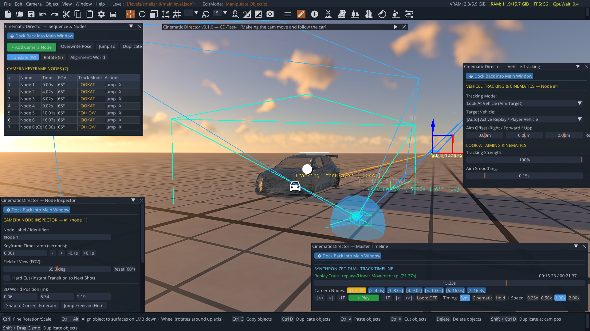
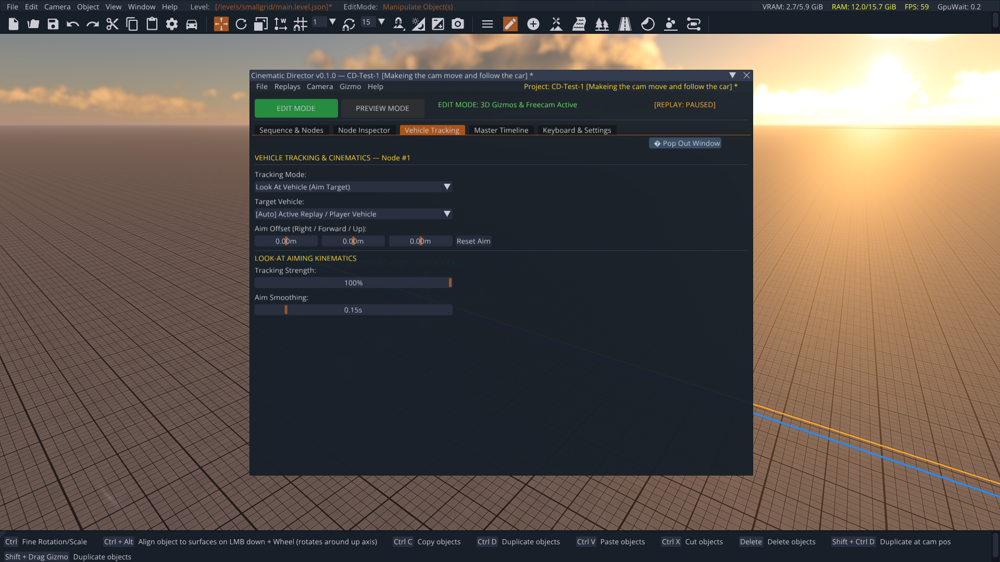
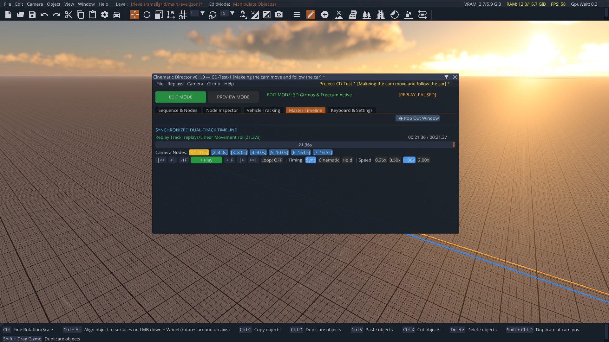
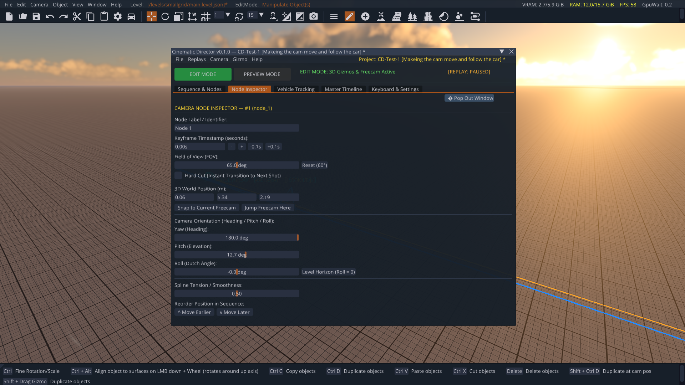
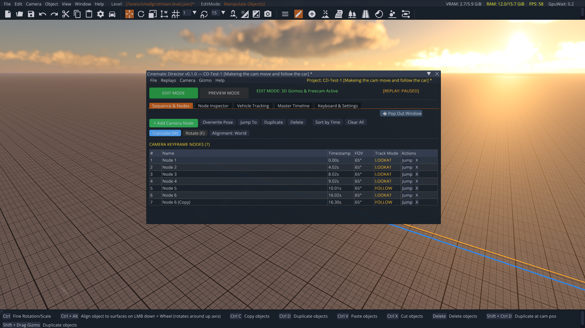
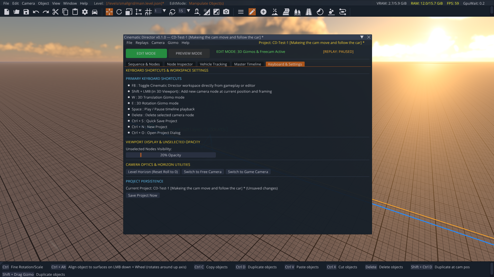

<p align="center">
  
  
  
  
</p>

<h1 align="center">🎬 Cinematic Director</h1>

<p align="center">
  <b>The Native 3D Camera Path Editor & Replay Cinematography Suite for BeamNG.drive</b>
</p>

<p align="center">
  <i>Created & Developed by <b><a href="https://github.com/JagaTheGhost">JagaTheGhost</a></b></i>
</p>

<p align="center">
  
</p>

---

## 🌟 Introduction

**Cinematic Director** is a comprehensive, native 3D camera path creation and cinematography production suite built directly inside **BeamNG.drive**. 

Designed specifically for automotive filmmakers, YouTubers, crash montage creators, and modders, Cinematic Director eliminates the frustration of clunky camera scripts and blind path guessing. It runs directly inside BeamNG's actual 3D simulation engine, utilizing the native World Editor, free-camera navigation, deterministic replay streaming, and Dear ImGui.

> [!TIP]
> **Zero External Tools Required:** Create, inspect, edit, track vehicles, and playback Hollywood-grade camera choreography in real time without ever leaving BeamNG.drive!

---

## 🎥 In-Game Showcase Video

Watch Cinematic Director in action — featuring real-time spline generation, modular pop-out panels, vehicle tracking, and replay synchronization:

<p align="center">
  <video src="assets/cinematic_director_showcase.mp4" controls width="100%" poster="assets/hero_modular_workspace.png">
    Your browser does not support the video tag.
  </video>
</p>

*(Click [here to download / view the high-definition showcase video directly](assets/cinematic_director_showcase.mp4))*

---

## 🚀 Key Feature Highlights

### 1. ⧉ Modular Pop-Out Multi-Window Workspace
Work the way *you* want. Cinematic Director provides an airy, modern tabbed workspace where **every major module can be detached into an independent floating window**:

* **Sequence & Keyframes Panel:** Manage nodes and shot order.
* **Camera Node Inspector:** Fine-tune 3D world coordinates, FOV, and roll angles.
* **Vehicle Tracking Suite:** Configure aim offsets and smoothing.
* **Master Timeline:** Control replay synchronization and playback transport.

> Move detached panels to a **second monitor**, snap them side-by-side, or dock them right back into the main window with a single click on **`[ ⇲ Dock Back into Main Window ]`**.

<p align="center">
  
</p>

---

### 2. 🎯 Direct 3D Viewport Interaction & Optical Frustums
Author your camera paths directly in the 3D game world:

* **Real-Time Optical Frustums:** Visual wireframes accurately represent each keyframe's Field of View (FOV), aspect ratio, and viewing direction.
* **Catmull-Rom Chordal Splines:** Generates mathematically smooth, centripetal camera curves through 3D space with animated motion direction arrows.
* **Full 3D Transform Gizmos:** Translate (`W`) and rotate (`E`) camera nodes in Local or World space with precision.
* **Viewport Raycasting:** Click any camera node in the 3D world to select it, or press `Shift + LMB` anywhere to instantly drop a new camera node at your current freecam framing.
* **Animated 3D Preview Camera:** An electric-cyan preview rig glides along your path during playback, allowing you to inspect camera kinematics and car clearances from any external freecam angle!

<p align="center">
  
</p>

---

### 3. 🚗 Intelligent Vehicle Kinematics & Tracking
Easily capture high-speed drifts, aerial jumps, and precision chases with 5 specialized tracking modes:

| Tracking Mode | Cinematic Behavior |
|---|---|
| **Free Camera** | Fully authored manual trajectory and orientation along the spline. |
| **Look At Vehicle** | Automatically locks camera aim to target vehicle while preserving authored camera roll (Dutch angles). |
| **Vehicle Follow** | Maintains an authored relative 3D offset behind, above, or beside the moving car. |
| **Vehicle Relative** | Rig-mount camera directly to vehicle chassis coordinates (wheel cams, bumper cams, chase mounts). |
| **Orbit Camera** | Revolves smoothly around the vehicle with configurable radius, elevation, speed, and phase. |

* **3D Aim Offsets:** Fine-tune the aim target point ($X, Y, Z$) to target the engine bay, front wheel, rear wing, or driver's cabin.
* **Jitter Suppression:** Exponential aim smoothing ($0.05\text{s} - 0.50\text{s}$) eliminates chassis vibration and harsh physics jitter.

<p align="center">
  
</p>

---

### 4. ⏱️ Synchronized Dual-Track Timeline
Locks camera motion directly to BeamNG's deterministic replay recording (`core_replay`):

* **Replay Track:** Visualizes total recording length, live playback time, and stream status.
* **Camera Keyframe Track:** Displays color-coded node triggers, jump points, and cut boundaries.
* **Unified Transport Controls:** Single-frame stepping (`-1F`, `+1F`), keyframe jumping (`<\|`, `\|>`), looping, and speed scaling ($0.25\times, 0.50\times, 1.00\times, 2.00\times$).
* **Simulation Sync:** Unified play/pause (`J` or `Space`) synchronizes replay playback directly with BeamNG physics pausing.

<p align="center">
  
</p>

---

### 5. 🔍 Precision Camera Node Inspector
Every camera node gives you pinpoint optical and kinematic control:

* **Field of View (FOV):** Continuous $15^\circ$ to $120^\circ$ optical zoom with a 1-click **Reset ($60^\circ$)** button.
* **Sub-Second Timestamp Nudging:** Adjust shot timing with $-0.1\text{s}$ and $+0.1\text{s}$ buttons.
* **Hard Cut Toggle:** Instantly switch between smooth spline transitions and dramatic instant hard cuts between shots.
* **Orientation Controls:** Exact Yaw (heading), Pitch (elevation), and Roll (Dutch angle) with a dedicated **Level Horizon** button.
* **Snap & Jump Utilities:** Snap node position to current freecam or teleport freecam directly into the node's vantage point.

<p align="center">
  
</p>

---

### 6. 📋 Keyframe Sequence Manager
Manage complex multi-shot cinematic sequences with ease:

* **Tabular Shot Overview:** Real-time summary of node index, name, timestamp, FOV, and tracking mode.
* **Batch Operations:** Quick jump, duplicate, delete, and 1-click **Sort by Time**.
* **Zero Disruption Workflow:** Switch between nodes without resetting playback position or losing camera orientation.

<p align="center">
  
</p>

---

### 7. ⌨️ Native Hotkeys & Proximity Fading
Integrated directly with BeamNG.drive's native hardware input system:

* **Hardware Toggle (`F8`):** Open or close Cinematic Director instantly from gameplay or editor mode without navigating menus.
* **Proximity-Aware Culling:** When jumping into a node or viewing it up close, the node sphere automatically fades out so you never experience yellow-screen blindness.
* **Dynamic Distance-Based Opacity:** When authoring near the animated preview camera or when it approaches head-on, its wireframe smoothly fades down from $100\%$ to $10\%$ opacity to preserve your field of view.
* **Selective Node Dimming:** Focused nodes remain bold and bright, while unselected nodes fade to an adjustable opacity ($5\% - 100\%$, default $20\%$).

<p align="center">
  
</p>

---

## ⌨️ Controls & Keyboard Shortcuts

| Shortcut | Action | Description |
|---|---|---|
| <kbd>F8</kbd> | **Toggle Cinematic Director** | Opens / closes the workspace directly from gameplay or World Editor (`cdToggleWindow`). |
| <kbd>J</kbd> or <kbd>Space</kbd> | **Play / Pause** | Toggles timeline playback and BeamNG simulation physics in sync. |
| <kbd>Shift</kbd> + <kbd>LMB</kbd> | **Add Camera Node** | Drops a new camera keyframe at the current freecam position and framing. |
| <kbd>W</kbd> | **Translate Gizmo** | Activates 3D position translation handles in the viewport. |
| <kbd>E</kbd> | **Rotate Gizmo** | Activates 3D rotation orientation rings in the viewport. |
| <kbd>Delete</kbd> | **Delete Keyframe** | Removes the currently selected camera node. |
| <kbd>Ctrl</kbd> + <kbd>S</kbd> | **Quick Save** | Saves the active cinematic project (`.cdproj.json`). |
| <kbd>Ctrl</kbd> + <kbd>N</kbd> | **New Project** | Clears the sequence and initializes a clean cinematic project. |
| <kbd>Ctrl</kbd> + <kbd>O</kbd> | **Open Project** | Opens the project browser dialog. |

---

## 📦 Installation & Setup

1. **Download:** Grab the latest `CinematicDirector.zip` release.
2. **Install:** Place `CinematicDirector.zip` directly into your BeamNG mods directory:
   ```text
   %LocalAppData%\BeamNG.drive\<version>\mods\CinematicDirector.zip
   ```
3. **Launch:** Start BeamNG.drive, load any map, and record or play a replay.
4. **Open:** Press <kbd>F8</kbd> to open Cinematic Director immediately!

---

## 💾 Project Persistence & Native Export

* **Native Project Format (`.cdproj.json`):** Saves 100% of camera keyframes, tracking modes, offsets, timeline metadata, and linked replay references.
* **Autosave Protection:** Periodic background autosave prevents any loss of work during long editing sessions.
* **1-Click Native Export (`.camPath.json`):** Export your camera sequence directly to BeamNG's built-in Camera Path player (`core_paths`) for vanilla compatibility!

---

## 👤 Author & Credits

* **Creator & Lead Developer:** **[JagaTheGhost](https://github.com/JagaTheGhost)**
* **Platform:** Developed for **BeamNG.drive**
* **Technologies:** Lua, BeamNG GE Extension Architecture, Dear ImGui, Vector/Quaternion Math Engine

---

<p align="center">
  <sub>Cinematic Director is an independent open-source modification for BeamNG.drive. All trademarks belong to their respective owners.</sub>
</p>
